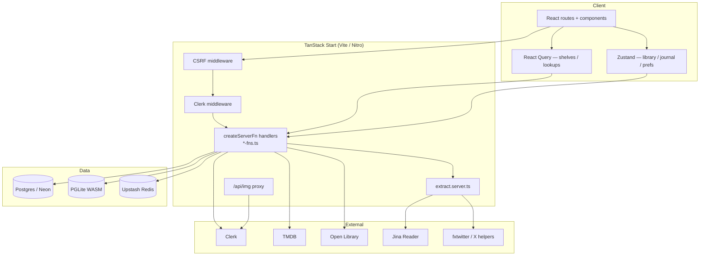
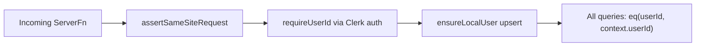
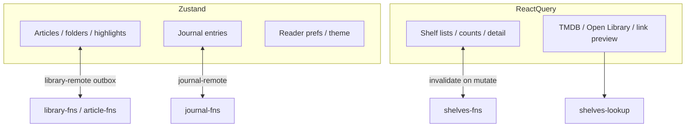
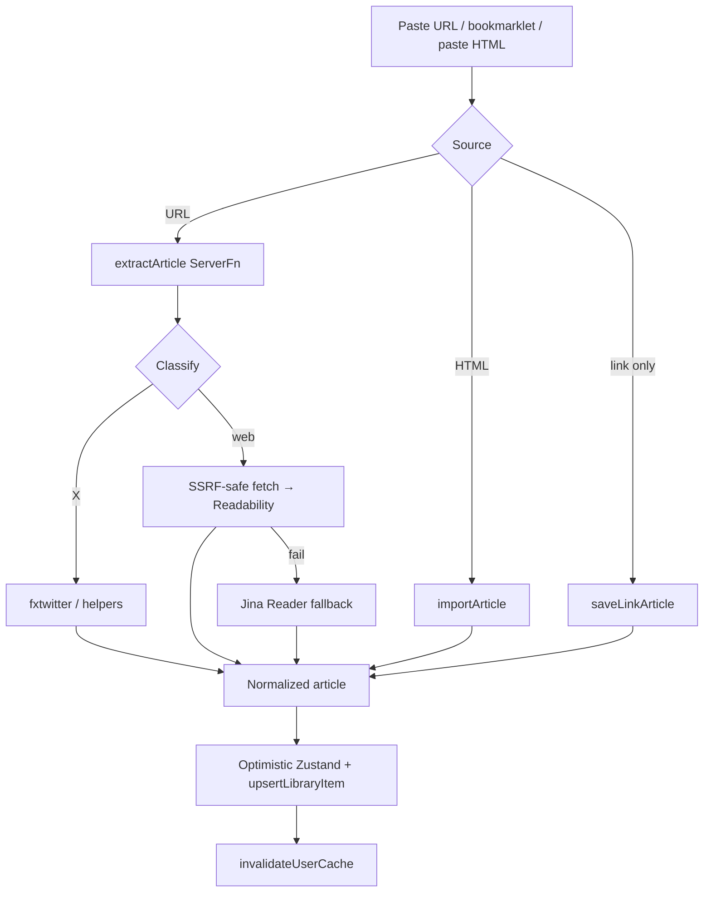
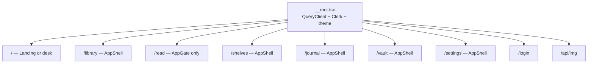
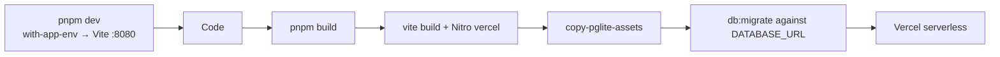

# Architecture

How KAMI (package name **quarto**) is put together — so you can change one layer without breaking another.

## Mental model

```
Browser (React + Zustand + React Query)
        │  createServerFn RPC (CSRF + Clerk)
        ▼
TanStack Start handlers  ──authMiddleware──►  context.userId
        │
        ├─ Drizzle → Postgres (DATABASE_URL) or PGLite
        ├─ extract.server.ts → Readability / Jina / X APIs
        └─ cache.server.ts → Upstash Redis (optional)
```

Signed-in users pass **`AppGate`**, which loads a per-user library + journal snapshot into **Zustand**. Mutations update the store immediately and sync through **`createServerFn` + Drizzle**, always scoped by Clerk **`userId`**. Shelves skip the optimistic store and use **React Query**. Article HTML is produced only on the server.

---

## System context



---

## Request lifecycle

```mermaid
sequenceDiagram
  participant B as Browser
  participant S as Start middleware
  participant F as ServerFn + authMiddleware
  participant D as Drizzle / DB
  participant R as Redis (optional)

  B->>S: RPC / navigation
  S->>S: CSRF (serverFn only)
  S->>S: clerkMiddleware
  B->>F: e.g. getLibrary()
  F->>F: assertSameSiteRequest
  F->>F: requireUserId → context.userId
  alt cache hit
    F->>R: GET quarto:v1:u:&lt;id&gt;:…
    R-->>F: payload
  else miss / no Redis
    F->>D: SELECT … WHERE user_id = context.userId
    D-->>F: rows
    F->>R: SET (if enabled)
  end
  F-->>B: typed result
  Note over B: Library/journal hydrate Zustand;<br/>shelves hydrate React Query
```

---

## Layering

| Layer | Location | Responsibility |
|-------|----------|----------------|
| Routes | `src/routes/*.tsx` | URL, search params, compose shell + page |
| UI | `src/components/**` | Presentation; call hooks / stores / ServerFns |
| Hooks | `src/hooks/**` | Capture, filters, TTS, shelf queries |
| Client state | `store.ts`, `journal.ts`, `*-remote.ts` | Optimistic library/journal + offline outbox |
| Server API | `*-fns.ts`, `shelves-lookup.ts` | Auth’d RPC, Zod validation, DB writes |
| Server-only | `*.server.ts` | Node/ALS code that must not ship to the browser |
| Schema | `schema.ts` + `migrations/*.sql` | Source of truth for tables |
| Bootstrap | `start.ts`, `router.tsx`, `__root.tsx` | Middleware, router, providers |

### File naming conventions

| Pattern | Meaning |
|---------|---------|
| `*-fns.ts` | `createServerFn` exports (server API) |
| `*-remote.ts` | Client sync / bootstrap / outbox |
| `*.server.ts` | Server-only module — never import from client components |
| `migrations/NNNN_*.sql` | Ordered SQL; basename recorded in `_migrations` |
| `@/` alias | Maps to `src/` |

Package/repo identifiers often say **quarto** (`quarto-library` localStorage key, `quarto:v1` Redis prefix, Docker `quarto-pg`). Product copy says **KAMI**.

---

## Auth & isolation



Rules that must not be broken:

1. **Never trust a client-supplied user id** — only `context.userId` from Clerk.
2. Scope every read/write with that id (or list ownership / membership for shelves).
3. `VITE_AUTH_ENABLED=false` is for local PGLite only; with a real `DATABASE_URL`, auth-off is fail-closed.
4. Global middleware in `src/start.ts`: CSRF for serverFns + `clerkMiddleware()`.
5. Per-function: `authMiddleware` from `src/lib/auth/middleware.ts`.

UI gates: `AppGate`, `SignedIn` / `SignedOut`, `/login`. Image proxy `/api/img` also checks Clerk when auth is enabled.

---

## Client state split



| Domain | Store | Why |
|--------|--------|-----|
| Library + highlights | Zustand + outbox | Large HTML bodies, optimistic UI, offline |
| Journal | Zustand + outbox | Same pattern |
| Shelves | React Query | Server-authoritative lists, easy invalidation |
| Lookups | React Query | External APIs with TTLs |

---

## Article capture pipeline



Extraction lives in `src/lib/extract.server.ts`. Public URL checks and redirect handling are intentional security surfaces — tighten, don’t bypass.

---

## Caching

`src/lib/cache.server.ts` — enabled only when both Upstash env vars are set.

- Key shape: `quarto:v1:u:<userId>:…`
- Read-through via `cached()`; writes call `invalidateUserCache(userId)`
- Oversized library snapshots skip cache
- Lookups (TMDB, books, previews) use longer TTLs

Locally (no Redis): every query hits Postgres/PGLite — expected.

---

## Routing & shell



- **`AppShell`**: header, nav panes, command palette, offline banner.
- **`AppGate`**: wait for auth + bootstrap library/journal once per user.
- **`/read`**: immersive — gate without full chrome.

File routes under `src/routes/` regenerate `src/routeTree.gen.ts` via the Vite router plugin. Do not hand-edit the generated tree.

---

## Build & deploy



`vercel.json` sets security headers and a CSP that allows Clerk (including the production Frontend API host `clerk.kami.sahilfruitwala.com`, Clerk CDN, Cloudflare Turnstile, and `*.protect.clerk.com`), fonts, and extraction helpers (`r.jina.ai`, fxtwitter/vxtwitter). `/api/img` gets a stricter CSP.

---

## Related docs

- [Data model](./DATA-MODEL.md) — tables and migrations
- [Development](./DEVELOPMENT.md) — env and local workflows
- [Contributing](./CONTRIBUTING.md) — how to change the app safely
