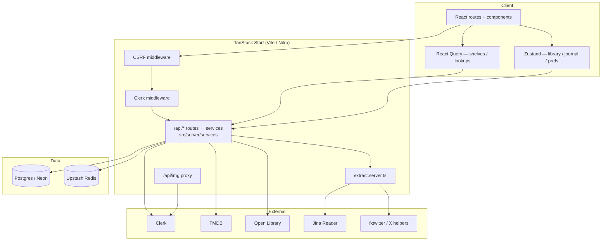
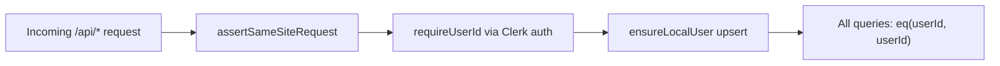
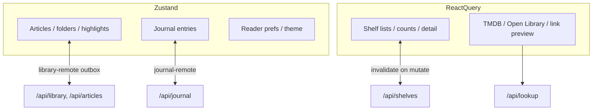
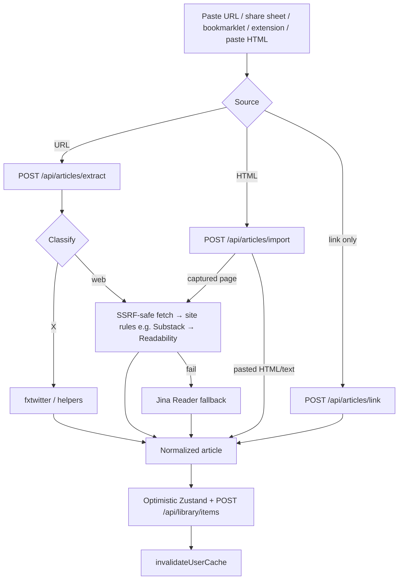
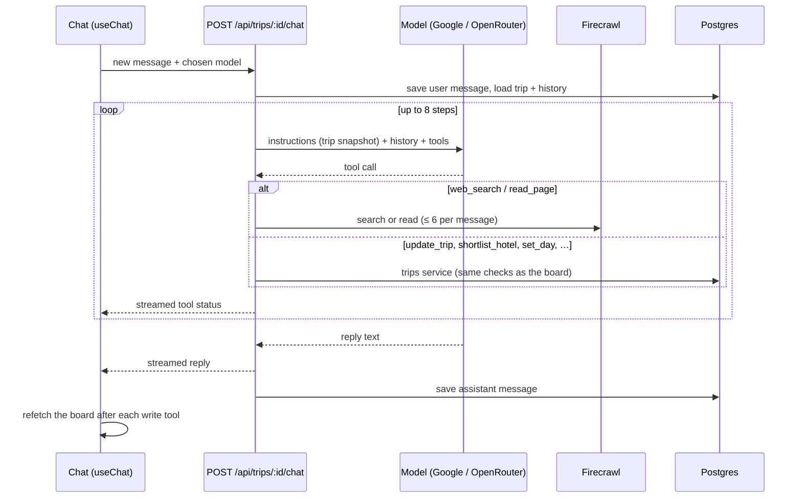
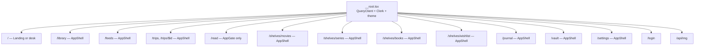
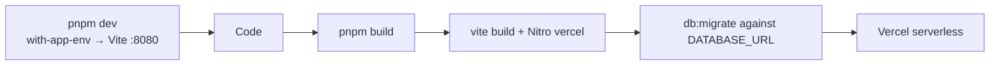

# Architecture

How KAMI (package name **quarto**) is put together — so you can change one layer without breaking another.

## Mental model

```
Browser (React + Zustand + React Query)
        │  fetch /api/* JSON (src/lib/api)
        ▼
src/routes/api/*  ──apiHandler (src/server/http.ts)──►  userId
        │
src/server/services/*  (business logic)
        │
        ├─ Drizzle → Postgres (DATABASE_URL)
        ├─ extract.server.ts → Readability / Jina / X APIs
        └─ cache.server.ts → Upstash Redis (optional)
```

Signed-in users pass **`AppGate`**, which loads a per-user library + journal snapshot into **Zustand**. Mutations update the store immediately and sync through the **REST API (`/api/*`) + Drizzle**, always scoped by Clerk **`userId`**. Shelves skip the optimistic store and use **React Query**. Article HTML is produced only on the server.

---

## System context



---

## Request lifecycle

```mermaid
sequenceDiagram
  participant B as Browser
  participant S as Start middleware
  participant F as /api route + apiHandler
  participant D as Drizzle / DB
  participant R as Redis (optional)

  B->>S: fetch /api/… / navigation
  S->>S: CSRF (/api/* only)
  S->>S: clerkMiddleware
  B->>F: e.g. GET /api/library
  F->>F: assertSameSiteRequest + JSON content-type
  F->>F: requireUserId → userId, rate limit, Zod parse
  alt cache hit
    F->>R: GET quarto:v1:u:&lt;id&gt;:…
    R-->>F: payload
  else miss / no Redis
    F->>D: SELECT … WHERE user_id = userId
    D-->>F: rows
    F->>R: SET (if enabled)
  end
  F-->>B: JSON (errors as { error } + status)
  Note over B: Library/journal hydrate Zustand;<br/>shelves hydrate React Query
```

---

## Layering

| Layer | Location | Responsibility |
|-------|----------|----------------|
| Routes | `src/routes/*.tsx` | URL, search params, compose shell + page |
| UI | `src/components/**` | Presentation; call hooks / stores / `src/lib/api` |
| Hooks | `src/hooks/**` | Capture, filters, TTS, shelf queries |
| Client state | `store.ts`, `journal.ts`, `*-remote.ts` | Optimistic library/journal + offline outbox |
| API client | `src/lib/api/**` | Typed `fetch` wrappers + shared request/response types |
| HTTP routes | `src/routes/api/**` | Method + path → service call; no business logic |
| HTTP layer | `src/server/http.ts` | Auth, same-site, rate limit, Zod, error → status |
| Services | `src/server/services/**` | Business logic, DB reads/writes, cache invalidation |
| Server-only | `*.server.ts` | Node/ALS code that must not ship to the browser |
| Schema | `schema.ts` + `migrations/*.sql` | Source of truth for tables |
| Bootstrap | `start.ts`, `router.tsx`, `__root.tsx` | Middleware, router, providers |

### File naming conventions

| Pattern | Meaning |
|---------|---------|
| `src/routes/api/**` | REST endpoints (see [API reference](./API.md)) |
| `src/server/**` | Server-only (guarded by `@tanstack/react-start/server-only`) |
| `*-remote.ts` | Client sync / bootstrap / outbox |
| `*.server.ts` | Server-only module — never import from client components |
| `migrations/NNNN_*.sql` | Ordered SQL; basename recorded in `_migrations` |
| `@/` alias | Maps to `src/` |

Package/repo identifiers often say **quarto** (`quarto-library` localStorage key, `quarto:v1` Redis prefix, Docker `quarto-pg`). Product copy says **KAMI**.

---

## Auth & isolation



Rules that must not be broken:

1. **Never trust a client-supplied user id** — only the `userId` `apiHandler` resolves from Clerk.
2. Scope every read/write with that id (or list ownership / membership for shelves).
3. `VITE_AUTH_ENABLED=false` is fail-closed — every request is rejected. Use Clerk for local dev.
4. Global middleware in `src/start.ts`: CSRF for `/api/*` + `clerkMiddleware()`.
5. Per-endpoint: every JSON route is wrapped in `apiHandler` (`src/server/http.ts`), which also requires an `application/json` body on writes.

UI gates: `AppGate`, Clerk `Show`, `/login`. Image proxy `/api/img` also checks Clerk when auth is enabled.

---

## Client state split



| Domain | Store | Why |
|--------|--------|-----|
| Library + highlights | Zustand + outbox | Large HTML bodies, optimistic UI, offline |
| Journal | Zustand + outbox | Same pattern |
| Shelves | React Query | Server-authoritative lists, easy invalidation |
| Lookups | React Query | External APIs with TTLs |

---

## Article capture pipeline



Extraction lives in `src/lib/extract.server.ts`. Public URL checks and redirect handling are intentional security surfaces — tighten, don’t bypass.

Site rules run before Readability when a site's markup is known: `src/lib/extract-substack.server.ts` takes Substack's `.body.markup` directly (custom domains included) and strips subscribe widgets / share buttons, unwraps image links, renders footnotes and embeds, and notes paywalled tails. Add new site rules alongside it.

### Browser capture handoff

The bookmarklet and the `extension/` browser extension capture the page in the user's browser and hand it to `/capture` with `postMessage` — never in a URL, so long articles aren't truncated:

1. `/capture` pings `kami:ready` to its opener (bookmarklet popup) and to itself (extension content script).
2. The sender answers with `kami:capture` + `{ url, title, html }` (scripts/styles stripped, ≤ 1.4 MB).
3. `/capture` accepts it only from its opener **for the opener's own origin**, or from same-origin/extension script; stashes it in `sessionStorage` and routes to `/app`, which imports it once the session is confirmed (`POST /api/articles/import` with `capture: true` → full extraction).

Legacy `?import=` links (`/` and `/app`) redirect to `/capture`. `/share` is the PWA Web Share Target (`site.webmanifest`): it takes the first URL from `url`/`text` and hands it to Home's normal save flow.

---

## Feeds & newsletters

`/feeds` follows RSS, Atom and JSON Feed sources and email newsletters. New
entries collect in a lightweight inbox, and saving one turns it into a normal
library work that you can read, highlight and keep.

### Design goals

You can follow hundreds of feeds without the server doing much work.

| Concern | How it's handled |
|---|---|
| Duplicate work | Feeds are **shared rows**. A blog followed by 100 readers is one row and one poll. Only feeds with at least one subscriber are ever polled. Unfollowed feeds are deleted with their entries. |
| Double polling | A poll **claims** feeds with `FOR UPDATE SKIP LOCKED` and pushes `next_fetch_at` forward 10 minutes as a lease. Overlapping refreshes, tabs or instances never fetch the same feed twice. If a run dies, the lease expires and the feed comes due again. |
| Bandwidth | Polls send a **conditional GET** (`If-None-Match` / `If-Modified-Since`), so an unchanged feed costs a `304` with no body. |
| Poll frequency | **On demand only**: nothing polls in the background. Each feed still tracks an adaptive schedule (the interval halves after new posts and grows 1.5× when nothing changed, between 30 minutes and 12 hours; publisher hints like `<ttl>`, `Cache-Control: max-age` and `Retry-After` can only lengthen it). The optional sweep hook uses that schedule. |
| Broken feeds | **Exponential backoff** on errors: 30 min, 1 h, 2 h, and so on up to 24 h. "Refresh all" skips a failing feed until its backoff ends; refreshing that one feed retries it. The last error is shown in the UI, and it clears after the next good poll. |
| Burst cost | Every run has a **feed cap, a concurrency cap and a wall-clock deadline**. Leases on feeds it didn't reach are released. Bodies are streamed under a 3 MB cap with a per-request timeout. |
| Manual refresh | The Refresh button never re-polls a feed checked in the last 5 minutes. Each request polls at most 20 feeds (5 at a time, 6-second budget) and reports how many remain; the client repeats up to 8 batches. It shares the `feeds` rate-limit bucket with adding feeds and importing OPML (60 per 10 min per user). |
| Saving | Entries keep the body the feed supplied, stored raw and capped. **Full-text feeds save with no network call at all**: the body is sanitized and built into an article on save. Only teaser feeds (under 150 words) fetch the page, once, through the normal extractor and its `extract` rate limit. |
| Storage | 100 entries are kept per feed, newest first. Read state is one row per explicit mark. "Mark all read" is a single timestamp per subscription. |
| Discovery | A known feed URL needs no fetch. A feed URL needs one fetch. A page needs its `<link rel="alternate">` feeds (up to 3), and only after that a few conventional paths, probed in parallel. OPML import registers feeds **without fetching**; the next Refresh fetches them. |
| SSRF | Every fetch goes through `safeFetch` (`src/lib/fetch-text.server.ts`), which re-validates each redirect hop against the private-address denylist and DNS. |

Unread means: no per-user mark, fetched after the subscription's `cleared_at`,
and published no more than 14 days before you subscribed. Following a blog with
years of archives therefore shows recent posts as unread, not the whole archive.

### When polling happens

Only when a user asks. There is **no cron and no automatic polling**:

- **Refresh all** on `/feeds` fetches every feed you follow that wasn't checked in the last 5 minutes, in batches of 20.
- **Refresh feed** (with one feed selected) fetches just that feed, retrying it even while it's failing.
- **Adding a feed** fetches it once while finding it, so its entries appear immediately.

Opening `/feeds` only reads what is already stored. Newsletters need no polling, since they arrive by email.

A sweep endpoint, `GET /api/hooks/feeds`, is kept for later but **nothing schedules it**. It polls every due subscribed feed on its adaptive schedule (up to 80 per run, 6 at a time, 25-second budget). It only answers when `CRON_SECRET` (16+ characters) is set and sent as `Authorization: Bearer …`; otherwise it returns `503`. To bring scheduled polling back, add a Vercel cron for it through Nitro's Vercel options in `vite.config.ts` (`nitro({ preset: "vercel", vercel: { config: { crons: [...] } } })`) or call it from any external scheduler.

### Newsletters by email

Each user can create a private address, `<token>@INBOUND_EMAIL_DOMAIN`. Mail
sent to it (plus-addressing like `token+brew@…` also works) is delivered to
`POST /api/hooks/inbound-email` by an inbound-mail provider:

- Each **sender** becomes a private feed, owned by that user and never shared.
- Tracking pixels and hidden preheader text are stripped. The "View in browser" link becomes the entry's URL.
- Nothing is polled. Unknown addresses, duplicates (same `Message-ID`) and floods over 300 per user per day are acknowledged with a `2xx` and dropped, so the provider doesn't retry them.
- Removing a sender deletes its feed. If the newsletter keeps mailing, the next issue starts a new one, so unsubscribe at the source too.
- "New address" rotates the token. Mail to the old address is dropped from then on.

Environment:

```bash
INBOUND_EMAIL_DOMAIN=in.example.com   # MX/route for this domain → your provider
INBOUND_EMAIL_SECRET=<32+ random chars>
```

Two common providers can send to the webhook:

**Postmark inbound**: set the inbound webhook URL to
`https://postmark:<INBOUND_EMAIL_SECRET>@your-app/api/hooks/inbound-email`. The
Basic-auth password is the secret. Postmark's JSON is accepted as is.

**Cloudflare Email Routing** (free): route `*@in.example.com` to an Email
Worker that forwards a small JSON payload:

```js
// worker.js — npm i postal-mime
import PostalMime from "postal-mime";

export default {
  async email(message, env) {
    const mail = await PostalMime.parse(message.raw);
    const res = await fetch(`${env.KAMI_URL}/api/hooks/inbound-email`, {
      method: "POST",
      headers: {
        "content-type": "application/json",
        authorization: `Bearer ${env.INBOUND_EMAIL_SECRET}`,
      },
      body: JSON.stringify({
        to: message.to,
        // Header From, not the envelope (bounce) sender, which changes per message.
        from: mail.from?.address ?? message.from,
        fromName: mail.from?.name,
        subject: mail.subject,
        html: mail.html,
        text: mail.text,
        date: mail.date,
        messageId: mail.messageId,
      }),
    });
    if (!res.ok) message.setReject(`KAMI returned ${res.status}`);
  },
};
```

Any other provider works if it posts the same generic shape:
`{ to, from, fromName?, subject?, html?, text?, date?, messageId? }`.

Many newsletters (Substack, Ghost, Buttondown, beehiiv) also publish RSS. Following
the newsletter's site as a feed needs no email setup at all.

### Code map

| Path | Role |
|---|---|
| `src/lib/feed-parse.server.ts` | RSS 2.0 / RDF / Atom / JSON Feed parsing, feed discovery (pure, tested) |
| `src/lib/feed-schedule.ts` | Interval, backoff, jitter and header-hint math (pure, tested) |
| `src/lib/newsletter-parse.server.ts` | Inbound payload normalization, tracking-pixel stripping (pure, tested) |
| `src/server/feeds/poller.ts` | Claim → conditional fetch → parse → insert → reschedule |
| `src/server/feeds/newsletter.ts` | Inbound email → private sender feed |
| `src/server/services/feeds.ts` | Subscriptions, entries, read state, save-to-library, inbox, OPML |
| `src/server/hooks.ts` | Shared-secret auth for `/api/hooks/*` (exempt from browser CSRF) |
| `src/routes/api/feeds/**`, `src/routes/api/hooks/**` | HTTP routes |
| `src/hooks/use-feeds.ts`, `src/components/feeds/*` | `/feeds` UI (React Query) |
| `migrations/0009_feeds.sql` | `feeds`, `feed_subscriptions`, `feed_entries`, `feed_entry_states`, `newsletter_inboxes` |

---

## Extracts (Firecrawl)

`/extracts` asks a web page a question and keeps the answers you approve. For
example: *Product Hunt — "the best products launched this week and this month,
with name, link and category"*.

1. **Save a source**: a URL plus a plain-English question (and an optional name).
   Sources are private to one user, up to 50 each.
2. **Run it** (on demand only — nothing is scheduled). The server calls
   Firecrawl `POST /v2/scrape` with the [`question` format](https://www.firecrawl.dev/blog/question-format-launch):

   ```json
   {
     "url": "https://www.producthunt.com/",
     "onlyMainContent": true,
     "maxAge": 172800000,
     "parsers": ["pdf"],
     "formats": [{ "type": "question", "question": "…" }]
   }
   ```

   **Run** reuses Firecrawl's cached copy of the page when it is under 2 days old
   (cheaper, faster). **Run live** sends `maxAge: 0` for a fresh fetch.
3. **Review**: the Markdown answer is stored as the source's single `pending`
   result and shown rendered. **Accept** keeps it in the source's history;
   **Discard** deletes it. Running again before reviewing replaces the pending one.

| Concern | Approach |
|---|---|
| Cost | Every run spends Firecrawl credits, so runs share a `firecrawl` rate-limit bucket (30 per hour per user). Nothing runs on page load. |
| Key | One server-wide `FIRECRAWL_API_KEY`; never sent to the browser. Without it the page explains the setup and Run is disabled. |
| Rendering | Answers are stored as raw Markdown and rendered with `markdownToHtml` + `sanitizeHtml` on read, so the browser only ever receives sanitized HTML (plus the Markdown for "Copy Markdown"). |
| Failures | A failed run records `last_error` on the source (shown in the UI) and keeps any earlier pending result. Upstream auth / credit errors are reported generically. |
| URLs | Same public-http(s) check as article capture (`assertPublicHttpUrl`); the fetch itself happens on Firecrawl's side. |

| Path | Role |
|---|---|
| `src/lib/firecrawl.server.ts` | Request builder, response parser (pure, tested), `askPage` |
| `src/server/services/extracts.ts` | Sources, runs, accept / discard, history |
| `src/routes/api/extracts/**` | HTTP routes |
| `src/hooks/use-extracts.ts`, `src/components/extracts/*` | `/extracts` UI (React Query) |
| `migrations/0010_extracts.sql` | `extract_sources`, `extract_results` |

---

## Trips

`/trips` is a private trip planner: a list of trips, and per trip a board with
the details (destination, start date, length, travellers, budget, what you
like), a **hotel shortlist**, and a **day-by-day itinerary**, plus a **trip
agent**: a chat beside the board that researches with Firecrawl and edits the
board through the same service a person uses.

| Concern | Approach |
|---|---|
| Dates | A trip stores `start_date` (optional) and `day_count` (1–30); the end date is derived, so the two can't disagree. Date math is UTC on `YYYY-MM-DD` strings (`src/lib/trip-days.ts`, tested). |
| Itinerary | Items carry a 0-based `day_index` and a `slot` (`morning` → `night`), ordered by day, slot, then `sort`. Moving an item to another day or slot puts it at the end there; the up/down buttons swap it with its neighbour inside the same day + slot (`POST /api/trips/:id/items/:itemId/move`). A trip can't be shortened past a day that still has plans. |
| Hotels | `shortlisted` or `chosen`; choosing one demotes the previous pick in the same transaction, and a partial unique index allows only one `chosen` per trip. Prices and ratings are free-text notes, never live data. |
| Writes | Every write returns the whole updated trip; the client swaps it into the React Query cache. Each write also bumps `trips.updated_at` so the list sorts by recent activity. |
| Limits | 50 trips per user, 30 hotels and 300 items per trip. Links go through `assertPublicHttpUrl`. |

### Trip agent



| Concern | Approach |
|---|---|
| Models | Vercel AI SDK v7 (`streamText`). `src/lib/llm.server.ts` is the only provider-aware file: `google:<model>` via `@ai-sdk/google`, `openrouter:<vendor/model>` via `@openrouter/ai-sdk-provider`. `TRIPS_MODELS` lists what the picker offers (default `google:gemini-3.8-flash`, then `openrouter:anthropic/claude-haiku-5.5`); entries without a provider key show as unavailable, and an unusable request falls back to the first usable model. The user's pick is remembered per browser. |
| Tools | Research: `web_search`, `read_page` (Firecrawl, only when `FIRECRAWL_API_KEY` is set). Writes: `update_trip`, `shortlist_hotel`, `update_hotel`, `remove_hotel`, `set_day`, `add_item`, `update_item`, `remove_item`, each bound to the signed-in user + this trip and calling `src/server/services/trips.ts`. Write tools answer with the fresh trip snapshot so the model always has current ids. Failures come back as `{ error }` for the model to recover from. |
| Undo | Before the agent's first write in a turn, `trip-undo.ts` saves the whole trip to `trip_snapshots` (one row per trip, replaced each turn). `POST /api/trips/:id/undo` restores details, hotels and itinerary with their original ids in one transaction and deletes the snapshot, so only the latest agent turn can be undone. |
| Safety | No booking, payment or messaging tools; the worst a misleading page can do is edit this one trip, which the user can undo. Page text is returned as `untrusted_page_content` and the instructions say never to follow it. URLs pass `assertPublicHttpUrl`. Only plain text from the client's message is used; the server builds the stored user message itself. Replies render through a small React Markdown renderer that only links http(s) URLs. |
| Cost | `agent` rate-limit bucket (40 messages/hour/user); 8 model steps and 6 Firecrawl calls per message (research tools are withdrawn once the 6 are spent, repeated searches and page reads in a turn are served from a per-turn cache, and only the text of the last 16 messages is re-sent as history, never old tool results); each Firecrawl call also counts against the shared `firecrawl` bucket. |
| History | `trip_messages` stores AI SDK UIMessages (newest 200 per trip). The model gets the last 30 plus a fresh trip snapshot in its instructions each turn. History that no longer validates against the tools is skipped rather than failing the turn. `consumeStream()` lets a turn finish and save even if the browser disconnects. |

| Path | Role |
|---|---|
| `src/lib/trip-days.ts` | Date math, day grouping, item order, move-within-slot (pure, tested) |
| `src/lib/trip-ics.ts` | Itinerary → `.ics` calendar text, built in the browser for the "Add to calendar" button (pure, tested) |
| `src/server/services/trip-undo.ts` | Agent undo snapshot: save, check, restore |
| `src/server/services/trips.ts` | Trips, hotels, itinerary items |
| `src/lib/trip-models.ts`, `src/lib/llm.server.ts` | Model menu parsing (pure, tested) and provider wiring |
| `src/lib/trip-agent-prompt.ts` | Agent instructions + trip snapshot (pure, tested) |
| `src/server/services/trip-agent.ts` | Tools, chat turn, history |
| `src/lib/firecrawl.server.ts` | `searchWeb`, `readPage` (alongside Extracts' `askPage`) |
| `src/routes/api/trips/**` | HTTP routes (`$id/chat` streams the agent) |
| `src/hooks/use-trips.ts`, `src/components/trips/*`, `src/routes/trips/*` | `/trips` UI, including `trip-chat.tsx` |
| `migrations/0012_trips.sql`, `migrations/0013_trip_messages.sql` | `trips`, `trip_hotels`, `trip_items`, `trip_messages` |

---

## Caching

`src/lib/cache.server.ts` — enabled only when both Upstash env vars are set.

- Key shape: `quarto:v1:u:<userId>:…`
- Read-through via `cached()`; writes call `invalidateUserCache(userId)`
- Oversized library snapshots skip cache
- Lookups (TMDB, books, previews) use longer TTLs

Locally (no Redis): every query hits Postgres — expected.

---

## Routing & shell



- **`AppShell`**: header, nav panes, command palette, offline banner.
- **`AppGate`**: wait for auth + bootstrap library/journal once per user.
- **`/read`**: immersive — gate without full chrome.

File routes under `src/routes/` regenerate `src/routeTree.gen.ts` via the Vite router plugin. Do not hand-edit the generated tree.

---

## Build & deploy



`vercel.json` sets security headers and a CSP that allows Clerk (including the production Frontend API host `clerk.kami.sahilfruitwala.com`, Clerk CDN, Cloudflare Turnstile, and `*.protect.clerk.com`), fonts, and extraction helpers (`r.jina.ai`, fxtwitter/vxtwitter). `/api/img` gets a stricter CSP.

---

## Related docs

- [API reference](./API.md) — REST endpoints
- [Data model](./DATA-MODEL.md) — tables and migrations
- [Development](./DEVELOPMENT.md) — env and local workflows
- [Contributing](./CONTRIBUTING.md) — how to change the app safely
