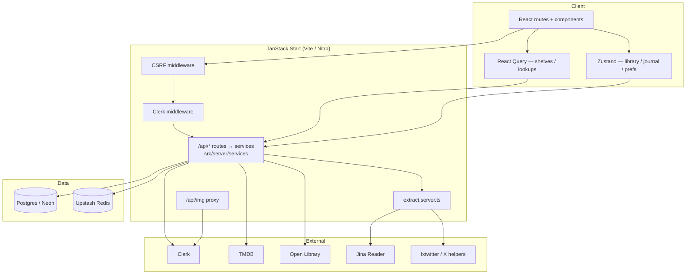
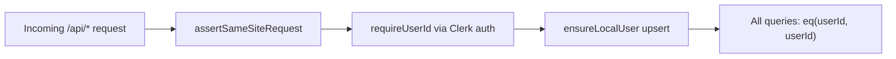
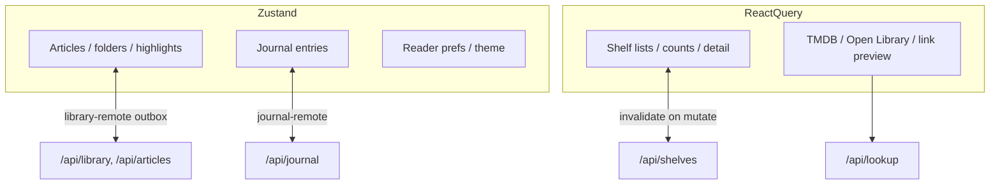
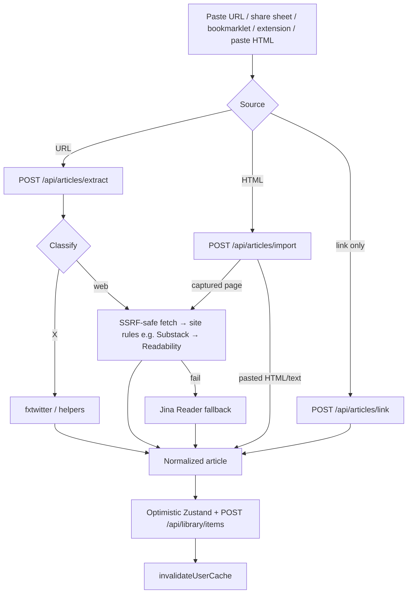
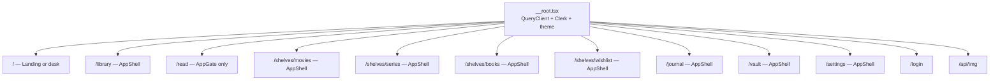
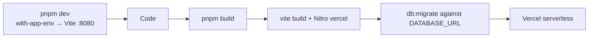

# Architecture

How KAMI (package name **quarto**) is put together — so you can change one layer without breaking another.

## Mental model

```
Browser (React + Zustand + React Query)
        │  fetch /api/* JSON (src/lib/api)
        ▼
src/routes/api/*  ──apiHandler (src/server/http.ts)──►  userId
        │
src/server/services/*  (business logic)
        │
        ├─ Drizzle → Postgres (DATABASE_URL)
        ├─ extract.server.ts → Readability / Jina / X APIs
        └─ cache.server.ts → Upstash Redis (optional)
```

Signed-in users pass **`AppGate`**, which loads a per-user library + journal snapshot into **Zustand**. Mutations update the store immediately and sync through the **REST API (`/api/*`) + Drizzle**, always scoped by Clerk **`userId`**. Shelves skip the optimistic store and use **React Query**. Article HTML is produced only on the server.

---

## System context



---

## Request lifecycle

```mermaid
sequenceDiagram
  participant B as Browser
  participant S as Start middleware
  participant F as /api route + apiHandler
  participant D as Drizzle / DB
  participant R as Redis (optional)

  B->>S: fetch /api/… / navigation
  S->>S: CSRF (/api/* only)
  S->>S: clerkMiddleware
  B->>F: e.g. GET /api/library
  F->>F: assertSameSiteRequest + JSON content-type
  F->>F: requireUserId → userId, rate limit, Zod parse
  alt cache hit
    F->>R: GET quarto:v1:u:&lt;id&gt;:…
    R-->>F: payload
  else miss / no Redis
    F->>D: SELECT … WHERE user_id = userId
    D-->>F: rows
    F->>R: SET (if enabled)
  end
  F-->>B: JSON (errors as { error } + status)
  Note over B: Library/journal hydrate Zustand;<br/>shelves hydrate React Query
```

---

## Layering

| Layer | Location | Responsibility |
|-------|----------|----------------|
| Routes | `src/routes/*.tsx` | URL, search params, compose shell + page |
| UI | `src/components/**` | Presentation; call hooks / stores / `src/lib/api` |
| Hooks | `src/hooks/**` | Capture, filters, TTS, shelf queries |
| Client state | `store.ts`, `journal.ts`, `*-remote.ts` | Optimistic library/journal + offline outbox |
| API client | `src/lib/api/**` | Typed `fetch` wrappers + shared request/response types |
| HTTP routes | `src/routes/api/**` | Method + path → service call; no business logic |
| HTTP layer | `src/server/http.ts` | Auth, same-site, rate limit, Zod, error → status |
| Services | `src/server/services/**` | Business logic, DB reads/writes, cache invalidation |
| Server-only | `*.server.ts` | Node/ALS code that must not ship to the browser |
| Schema | `schema.ts` + `migrations/*.sql` | Source of truth for tables |
| Bootstrap | `start.ts`, `router.tsx`, `__root.tsx` | Middleware, router, providers |

### File naming conventions

| Pattern | Meaning |
|---------|---------|
| `src/routes/api/**` | REST endpoints (see [API reference](./API.md)) |
| `src/server/**` | Server-only (guarded by `@tanstack/react-start/server-only`) |
| `*-remote.ts` | Client sync / bootstrap / outbox |
| `*.server.ts` | Server-only module — never import from client components |
| `migrations/NNNN_*.sql` | Ordered SQL; basename recorded in `_migrations` |
| `@/` alias | Maps to `src/` |

Package/repo identifiers often say **quarto** (`quarto-library` localStorage key, `quarto:v1` Redis prefix, Docker `quarto-pg`). Product copy says **KAMI**.

---

## Auth & isolation



Rules that must not be broken:

1. **Never trust a client-supplied user id** — only the `userId` `apiHandler` resolves from Clerk.
2. Scope every read/write with that id (or list ownership / membership for shelves).
3. `VITE_AUTH_ENABLED=false` is fail-closed — every request is rejected. Use Clerk for local dev.
4. Global middleware in `src/start.ts`: CSRF for `/api/*` + `clerkMiddleware()`.
5. Per-endpoint: every JSON route is wrapped in `apiHandler` (`src/server/http.ts`), which also requires an `application/json` body on writes.

UI gates: `AppGate`, Clerk `Show`, `/login`. Image proxy `/api/img` also checks Clerk when auth is enabled.

---

## Client state split



| Domain | Store | Why |
|--------|--------|-----|
| Library + highlights | Zustand + outbox | Large HTML bodies, optimistic UI, offline |
| Journal | Zustand + outbox | Same pattern |
| Shelves | React Query | Server-authoritative lists, easy invalidation |
| Lookups | React Query | External APIs with TTLs |

---

## Article capture pipeline



Extraction lives in `src/lib/extract.server.ts`. Public URL checks and redirect handling are intentional security surfaces — tighten, don’t bypass.

Site rules run before Readability when a site's markup is known: `src/lib/extract-substack.server.ts` takes Substack's `.body.markup` directly (custom domains included) and strips subscribe widgets / share buttons, unwraps image links, renders footnotes and embeds, and notes paywalled tails. Add new site rules alongside it.

### Browser capture handoff

The bookmarklet and the `extension/` browser extension capture the page in the user's browser and hand it to `/capture` with `postMessage` — never in a URL, so long articles aren't truncated:

1. `/capture` pings `kami:ready` to its opener (bookmarklet popup) and to itself (extension content script).
2. The sender answers with `kami:capture` + `{ url, title, html }` (scripts/styles stripped, ≤ 1.4 MB).
3. `/capture` accepts it only from its opener **for the opener's own origin**, or from same-origin/extension script; stashes it in `sessionStorage` and routes to `/app`, which imports it once the session is confirmed (`POST /api/articles/import` with `capture: true` → full extraction).

Legacy `?import=` links (`/` and `/app`) redirect to `/capture`. `/share` is the PWA Web Share Target (`site.webmanifest`): it takes the first URL from `url`/`text` and hands it to Home's normal save flow.

---

## Caching

`src/lib/cache.server.ts` — enabled only when both Upstash env vars are set.

- Key shape: `quarto:v1:u:<userId>:…`
- Read-through via `cached()`; writes call `invalidateUserCache(userId)`
- Oversized library snapshots skip cache
- Lookups (TMDB, books, previews) use longer TTLs

Locally (no Redis): every query hits Postgres — expected.

---

## Routing & shell



- **`AppShell`**: header, nav panes, command palette, offline banner.
- **`AppGate`**: wait for auth + bootstrap library/journal once per user.
- **`/read`**: immersive — gate without full chrome.

File routes under `src/routes/` regenerate `src/routeTree.gen.ts` via the Vite router plugin. Do not hand-edit the generated tree.

---

## Build & deploy



`vercel.json` sets security headers and a CSP that allows Clerk (including the production Frontend API host `clerk.kami.sahilfruitwala.com`, Clerk CDN, Cloudflare Turnstile, and `*.protect.clerk.com`), fonts, and extraction helpers (`r.jina.ai`, fxtwitter/vxtwitter). `/api/img` gets a stricter CSP.

---

## Related docs

- [API reference](./API.md) — REST endpoints
- [Data model](./DATA-MODEL.md) — tables and migrations
- [Development](./DEVELOPMENT.md) — env and local workflows
- [Contributing](./CONTRIBUTING.md) — how to change the app safely
