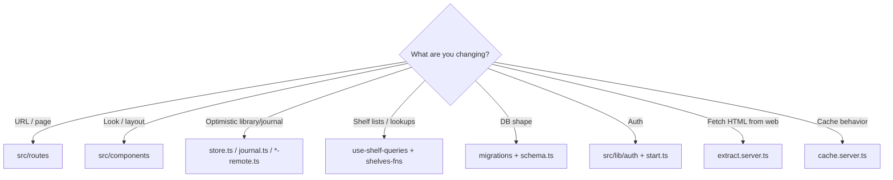

# Contributing

Practical guide for changing KAMI without fighting the architecture.

If you have not set up the app yet, start with [Development](./DEVELOPMENT.md). For the big picture, see [Architecture](./ARCHITECTURE.md).

---

## Before you open a PR

1. Branch from latest `master`.
2. Keep changes focused — one concern per PR when possible.
3. Run `pnpm typecheck` (and `pnpm test` if you touched `scripts/`).
4. Prefer matching existing naming (`*-fns.ts`, `*.server.ts`, Kami CSS tokens).
5. Never commit `.env`, secrets, or real user data dumps.

---

## Common change recipes

### 1. Add a new page / route

1. Create `src/routes/my-feature.tsx`:

```tsx
import { createFileRoute } from "@tanstack/react-router";
import { AppShell } from "@/components/app-shell";

export const Route = createFileRoute("/my-feature")({
  component: MyFeaturePage,
});

function MyFeaturePage() {
  return (
    <AppShell>
      {/* page content */}
    </AppShell>
  );
}
```

2. For immersive UIs (like `/read`), wrap with `AppGate` only — skip full chrome.
3. Let the Vite router plugin regenerate `src/routeTree.gen.ts` (do not hand-edit).
4. If it is a primary “sanctuary” pane, add it to nav in `src/components/site-header.tsx` (`PANES` / `SitePane`).

### 2. Add a ServerFn (API)

Put it in the right `src/lib/*-fns.ts` (or a new module next to peers).

```ts
import { createServerFn } from "@tanstack/react-start";
import { z } from "zod";
import { authMiddleware } from "@/lib/auth/middleware";
import { getDb } from "@/lib/db";
import { invalidateUserCache } from "@/lib/cache.server";

const Input = z.object({ /* … */ });

export const doThing = createServerFn({ method: "POST" })
  .middleware([authMiddleware])
  .validator((input) => Input.parse(input))
  .handler(async ({ context, data }) => {
    const db = await getDb();
    // ALWAYS scope by context.userId
    // …
    await invalidateUserCache(context.userId);
    return { ok: true as const };
  });
```

Checklist:

- [ ] `.middleware([authMiddleware])`
- [ ] Zod `.validator`
- [ ] Queries/mutations filtered by `context.userId` (or verified list membership)
- [ ] Writes call `invalidateUserCache(context.userId)`
- [ ] Server-only imports stay in `*.server.ts` or behind dynamic import if needed

Client call sites look like `await doThing({ data: { … } })`.

For shelves, prefer React Query hooks in `src/hooks/use-shelf-queries.ts` and keys in `src/lib/query-client.ts`. For library/journal, go through `*-remote.ts` so the outbox stays consistent.

### 3. Change the database schema

1. Add `migrations/0006_descriptive_name.sql` with forward-only SQL.
2. Mirror columns/tables in `src/lib/schema.ts`.
3. Apply:

```bash
pnpm db:migrate          # Postgres (required)
```

4. Update any ServerFns / types that assume the old shape.

Do **not** edit already-shipped migration files on shared DBs. See [Data model](./DATA-MODEL.md).

### 4. Add or change UI

| Kind | Where |
|------|--------|
| Feature screens | `src/components/<area>/` |
| Primitives | `src/components/ui/` (shadcn / Base UI — see `components.json`) |
| Brand atoms | `src/components/kami.tsx`, tokens in `src/styles.css` |
| Hooks | `src/hooks/` |

Reuse existing patterns: `kami-desk`, paper/ink CSS variables, `Button` from `ui/button`. Prefer composition over new card-heavy layouts unless the interaction needs a card.

### 5. Add a shelf item type

1. SQL table + Drizzle table (copy the `shelfBase()` pattern in `schema.ts`).
2. Extend `ITEM_TYPES` / `LIST_TYPES`.
3. Wire `tableForType` / `addShelfItem` (and related switches) in `shelves-db.server.ts` / `shelves-write-fns.ts`.
4. Add a route under `/shelves/<type>` (`SHELF_TABS` / `SHELF_PATHS`) and a sidebar pane in `site-header.tsx`.
5. Optional: lookup ServerFn in `shelves-lookup.ts`, query keys + hooks.
6. Invalidate React Query caches on mutate.

### 6. Touch article extraction

Server-only: `src/lib/extract.server.ts` + thin wrappers in `article-fns.ts`.

- Keep SSRF checks and public-URL validation.
- New third-party hosts may need CSP `connect-src` updates in `vercel.json`.
- Prefer fallbacks (Readability → Jina → link-only) over failing hard.

### 7. Auth / gates

| Need | File |
|------|------|
| Server identity | `src/lib/auth/verify.server.ts` |
| ServerFn middleware | `src/lib/auth/middleware.ts` |
| Same-site isolation | `src/lib/auth/isolation.server.ts` |
| React provider | `src/lib/auth/provider.tsx` |
| Sign-in UI helpers | `src/lib/auth/gates.tsx` |
| Global middleware | `src/start.ts` |

Do not invent a parallel session system — Clerk is the source of truth.

---

## Code style norms

- **TypeScript strict** — fix type errors rather than `any`-casting around them.
- **Imports**: `@/` alias; many files keep explicit `.ts` / `.tsx` extensions — match neighbors.
- **Validation**: Zod at ServerFn boundaries.
- **IDs**: treat as opaque text; authorization is always user/list scoped.
- **Comments**: explain non-obvious security or migration rationale; skip restating the code.

---

## Decision tree: where does this change go?



---

## Security reminders (short)

- Scope every DB access by authenticated user (or verified membership).
- Do not disable `assertSameSiteRequest` / CSRF for convenience.
- Image proxy and extract paths must keep SSRF hardening.
- Secrets only in env — never in client bundles (`CLERK_SECRET_KEY`, Redis token, DB URL).

---

## Getting unstuck

1. Search for a similar feature (`Grep` for `createServerFn`, `createFileRoute`, `shelfBase`).
2. Read the module header comments — several files document invariants inline (`db.ts`, `migrate.mjs`, auth middleware).
3. Check [Architecture](./ARCHITECTURE.md) diagrams for which layer owns the concern.
