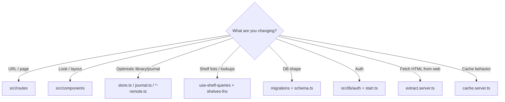

# Contributing

Practical guide for changing KAMI without fighting the architecture.

If you have not set up the app yet, start with [Development](./DEVELOPMENT.md). For the big picture, see [Architecture](./ARCHITECTURE.md).

---

## Before you open a PR

1. Fork the repo and branch from latest `master`.
2. Keep changes focused — one concern per PR when possible.
3. Run `pnpm typecheck`, `pnpm lint`, `pnpm format:check` and `pnpm test` (tests live in `tests/`) — CI runs all four.
4. Prefer matching existing naming (`src/server/services/*`, `src/routes/api/*`, `*.server.ts`, Kami CSS tokens).
5. Never commit `.env`, secrets, or real user data dumps.
6. By contributing you agree your work is licensed under the project's [MIT License](../LICENSE).

---

## Common change recipes

### 1. Add a new page / route

1. Create `src/routes/my-feature.tsx`:

```tsx
import { createFileRoute } from "@tanstack/react-router";
import { AppShell } from "@/components/app-shell";

export const Route = createFileRoute("/my-feature")({
  component: MyFeaturePage,
});

function MyFeaturePage() {
  return <AppShell>{/* page content */}</AppShell>;
}
```

2. For immersive UIs (like `/read`), wrap with `AppGate` only — skip full chrome.
3. Let the Vite router plugin regenerate `src/routeTree.gen.ts` (do not hand-edit).
4. If it is a primary “sanctuary” pane, add it to nav in `src/components/site-header.tsx` (`PANES` / `SitePane`).

### 2. Add an API endpoint

An endpoint is a few small pieces — keep business logic out of the route file.

**a. Request schema** — `src/lib/api/schemas/<domain>.ts` (isomorphic: Zod + `src/lib` pure helpers only, no DB or server imports). The server validates with it and the client derives its request type from it, so the two can't drift (see `schemas/library.ts`, `schemas/trips.ts`):

```ts
import { z } from "zod";

export const doThingBody = z.object({/* … */});
```

**b. Service** — `src/server/services/<domain>.ts` (plain async functions, server-only):

```ts
import "@tanstack/react-start/server-only";
import { z } from "zod";
import { getDb } from "@/lib/db.server";
import { invalidateUserCache } from "@/lib/cache.server";
import { notFound } from "@/server/http";
import { doThingBody } from "@/lib/api/schemas/<domain>";

export { doThingBody }; // routes import schemas from the service

export async function doThing(userId: string, id: string, data: z.output<typeof doThingBody>) {
  const db = await getDb();
  // ALWAYS scope by userId; throw notFound()/conflict()/badRequest() for user-facing errors
  // …
  await invalidateUserCache(userId, "library"); // the feature this write changes
  return { ok: true as const };
}
```

**c. Route** — `src/routes/api/<domain>/$id/thing.ts`:

```ts
import { createFileRoute } from "@tanstack/react-router";
import { z } from "zod";
import { apiHandler } from "@/server/http";
import { doThing, doThingBody } from "@/server/services/<domain>";

const params = z.object({ id: z.string().min(1).max(200) });

export const Route = createFileRoute("/api/<domain>/$id/thing")({
  server: {
    handlers: {
      POST: apiHandler({ params, body: doThingBody }, ({ userId, params, body }) =>
        doThing(userId, params.id, body),
      ),
    },
  },
});
```

**d. Client** — add a method to `src/lib/api/<domain>.ts`, typing the body from the schema (type-only import — ESLint rejects a value import here, so Zod stays out of the bundle):

```ts
import type { z } from "zod";
import type { doThingBody } from "./schemas/<domain>";

export type DoThingInput = z.input<typeof doThingBody>;

doThing: (id: string, input: DoThingInput) => http.post<{ ok: true }>(`/api/<domain>/${seg(id)}/thing`, input),
```

Checklist:

- [ ] Route wraps its handler in `apiHandler` (auth, same-site, JSON body, Zod, error mapping)
- [ ] `rateLimit: "lookup" | "extract"` when the service fetches from the outside world
- [ ] Queries/mutations filtered by `userId` (or verified list membership)
- [ ] Writes call `invalidateUserCache(userId, feature)` for each cached feature they change (cached reads use `userFeatureKey`)
- [ ] Request body schema lives in `src/lib/api/schemas/`; the client type is `z.input<>` of it
- [ ] Shared response types live in `src/lib/api/types.ts` — never import `src/server/**` from client code (ESLint enforces this)
- [ ] REST shape: `GET` reads, `POST` create/actions, `PATCH` partial update, `PUT` replace/set, `DELETE` remove; 404 for missing-or-not-yours
- [ ] Endpoint listed in [`docs/API.md`](./API.md)

Server data in components goes through hooks in `src/hooks/` (`use-shelf-queries.ts`, `use-ai.ts`, `use-feeds.ts`, …): every `useQuery` / `useMutation` lives there, keyed through the `queryKeys` factory in `src/lib/query-client.ts`, with its invalidation and error toast. ESLint rejects React Query hooks imported straight into components or pages. One-off imperative calls (export a file, save on click) may call `src/lib/api` directly. For library/journal, go through `*-remote.ts` so the outbox stays consistent.

### 3. Change the database schema

1. Add `migrations/0006_descriptive_name.sql` with forward-only SQL.
2. Mirror columns/tables in `src/lib/schema.ts`.
3. Apply:

```bash
pnpm db:migrate          # Postgres (required)
```

4. Update any services / API types that assume the old shape.

Do **not** edit already-shipped migration files on shared DBs. See [Data model](./DATA-MODEL.md).

### 4. Add or change UI

| Kind            | Where                                                           |
| --------------- | --------------------------------------------------------------- |
| Feature screens | `src/components/<area>/`                                        |
| Primitives      | `src/components/ui/` (shadcn / Base UI — see `components.json`) |
| Brand atoms     | `src/components/kami.tsx`, tokens in `src/styles.css`           |
| Hooks           | `src/hooks/`                                                    |

Reuse existing patterns: `kami-desk`, paper/ink CSS variables, `Button` from `ui/button`. Prefer composition over new card-heavy layouts unless the interaction needs a card.

### 5. Add a shelf item type

1. SQL table + Drizzle table (copy the `shelfBase()` pattern in `schema.ts`).
2. Extend `ITEM_TYPES` / `LIST_TYPES`.
3. Wire `tableForType` / `addShelfItem` (and related switches) in `shelves-db.server.ts` / `src/server/services/shelves-write.ts`.
4. Add a route under `/shelves/<type>` (`SHELF_TABS` / `SHELF_PATHS`) and an entry in the shelf menu in `site-header.tsx`.
5. Optional: lookup in `src/server/services/lookup.ts` + `/api/lookup/*` route, query keys + hooks.
6. Invalidate React Query caches on mutate.

### 6. Touch article extraction

Server-only: `src/lib/extract.server.ts` + thin wrappers in `src/server/services/articles.ts`.

- Keep SSRF checks and public-URL validation.
- New third-party hosts may need CSP `connect-src` updates in `src/lib/csp.ts`. Inline scripts must go through `ScriptOnce` (or carry `router.options.ssr.nonce`) or the CSP blocks them.
- Prefer fallbacks (Readability → Jina → link-only) over failing hard.

### 7. Auth / gates

| Need                | File                                |
| ------------------- | ----------------------------------- |
| Server identity     | `src/lib/auth/verify.server.ts`     |
| API auth wrapper    | `src/server/http.ts` (`apiHandler`) |
| Same-site isolation | `src/lib/auth/isolation.server.ts`  |
| React provider      | `src/lib/auth/provider.tsx`         |
| Sign-in UI helpers  | `src/lib/auth/gates.tsx`            |
| Global middleware   | `src/start.ts`                      |

Do not invent a parallel session system — Clerk is the source of truth.

---

## Code style norms

- **TypeScript strict** — fix type errors rather than `any`-casting around them.
- **Imports**: `@/` alias; many files keep explicit `.ts` / `.tsx` extensions — match neighbors.
- **Validation**: Zod at ServerFn boundaries.
- **IDs**: treat as opaque text; authorization is always user/list scoped.
- **Comments**: explain non-obvious security or migration rationale; skip restating the code.

---

## Decision tree: where does this change go?



---

## Security reminders (short)

- Scope every DB access by authenticated user (or verified membership).
- Do not disable `assertSameSiteRequest` / CSRF for convenience.
- Image proxy and extract paths must keep SSRF hardening.
- Secrets only in env — never in client bundles (`CLERK_SECRET_KEY`, Redis token, DB URL).

---

## Getting unstuck

1. Search for a similar feature (`Grep` for `createServerFn`, `createFileRoute`, `shelfBase`).
2. Read the module header comments — several files document invariants inline (`db.ts`, `migrate.mjs`, auth middleware).
3. Check [Architecture](./ARCHITECTURE.md) diagrams for which layer owns the concern.
