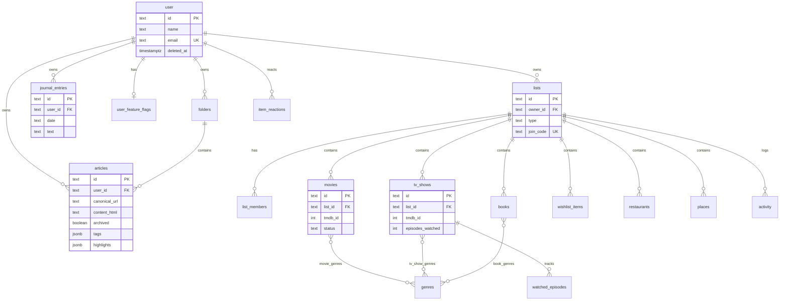
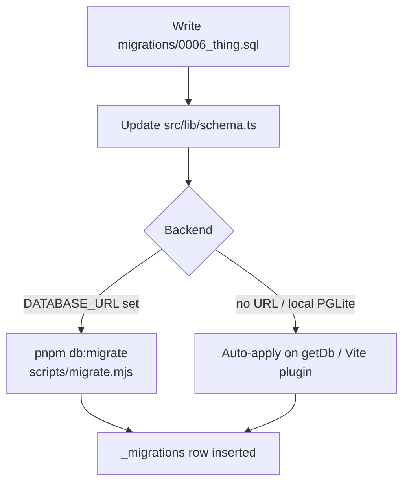

# Data model

Schema lives in two places that must stay in sync:

1. **SQL** — `migrations/NNNN_*.sql` (applied at deploy / PGLite boot)
2. **Drizzle** — `src/lib/schema.ts` (TypeScript types + query builder)

Column names in Postgres are **snake_case**. Drizzle fields are **camelCase** mapped via column name strings.

---

## Entity overview

---

## Domains

### Auth mirror — `user`

Clerk owns identity. We keep a local row so library tables can FK `user_id`.

| Column | Notes |
|--------|--------|
| `id` | Clerk user id (text PK) |
| `name`, `email`, `emailVerified`, `image` | Synced / upserted on first ServerFn |
| `deleted_at`, `purge_after` | Soft-delete / purge scheduling |

Legacy Better Auth session/account/verification tables may exist in older DBs but are unused.

### Library — `folders`, `articles`

| Table | Purpose |
|-------|---------|
| `folders` | Per-user named folders |
| `articles` | Saved reads — HTML body, tags, highlights, archive/favorite flags |

Important constraints:

- Unique `(user_id, canonical_url)` — one save per URL per user
- Indexes on `(user_id)`, `(user_id, archived)`
- `folder_id` → `folders` with `ON DELETE SET NULL`
- `tags` and `highlights` are **jsonb**

### Journal — `journal_entries`

One row per user per calendar `date` (text, unique with `user_id`). Autosaved from the journal UI via `upsertJournalEntry`.

### Shelves — lists + typed items

| Table | Role |
|-------|------|
| `lists` | Shelf container (`type`: movie, tv, book, wishlist, …) |
| `list_members` | Shared list membership (`owner` / `editor`) |
| `movies`, `tv_shows`, `books`, `wishlist_items` | Typed items (UI tabs) |
| `restaurants`, `places` | In schema; not currently exposed as primary UI tabs |
| `genres` + join tables | Genre tags for movie/TV/book |
| `activity` | List activity feed |
| `item_reactions` | Per-user reactions on items |
| `watched_episodes` | Episode-level TV progress |

Shared item fields (via `shelfBase()` in schema): `title`, `notes`, `link`, `image_url`, `status` (`to_try` \| `done` \| `abandoned`), `group_name`, `extra_metadata`, `added_by`, timestamps.

Movie/TV uniqueness (partial indexes):

- `(list_id, tmdb_id)` when TMDB id present
- `(list_id, normalized_title)` when title present

### Misc

| Table | Role |
|-------|------|
| `user_feature_flags` | e.g. sharing toggle |
| `rate_limits` | Simple key/window counters |
| `_migrations` | Migration bookkeeping (not in Drizzle schema) |

---

## Migration workflow

Rules:

1. Add a **new numbered file** — never edit an already-applied migration on shared environments.
2. Keep the glob **non-recursive**: only `migrations/*.sql` is applied. `migrations/auth/` is opt-in until copied up.
3. Order is by basename; each file runs in one transaction.
4. `drizzle-kit` is a devDependency but the **canonical path is hand-written SQL**, not `drizzle-kit push`.

---

## ID conventions

- Most PKs are **text UUIDs**.
- Article ids may start URL-derived and be rewritten server-side on conflict.
- Always filter by `user_id` / list ownership — ids alone are not an authorization boundary.

---

## Where code touches the schema

| Concern | Module |
|---------|--------|
| Table definitions | `src/lib/schema.ts` |
| Library CRUD | `src/lib/library-fns.ts` |
| Article extract/save | `src/lib/article-fns.ts` |
| Journal CRUD | `src/lib/journal-fns.ts` |
| Shelves CRUD | `src/lib/shelves-fns.ts` |
| Lookups | `src/lib/shelves-lookup.ts`, `shelves-episodes.ts` |
| DB client | `src/lib/db.ts` |
