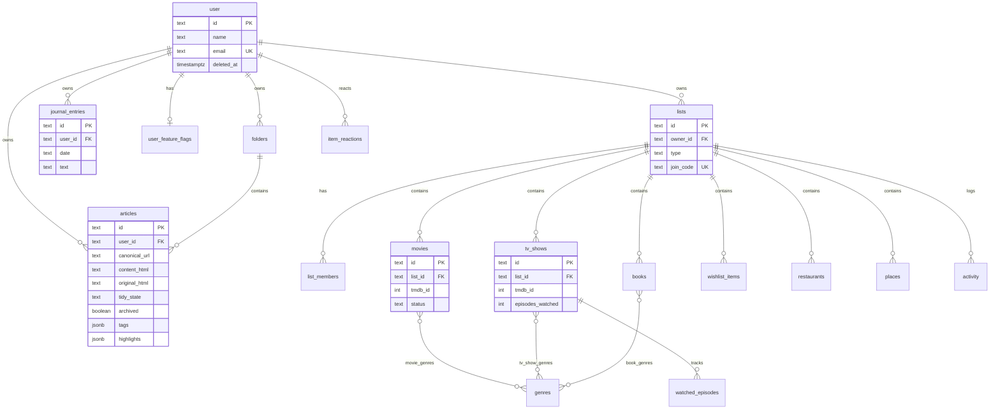
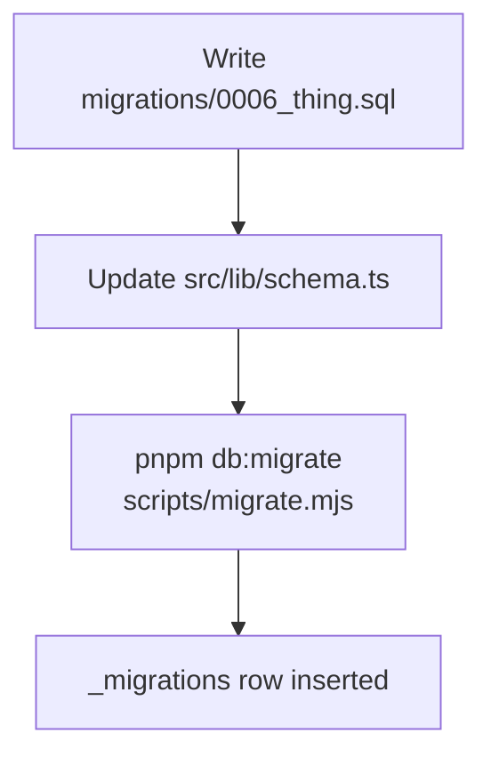

# Data model

Schema lives in two places that must stay in sync:

1. **SQL** — `migrations/NNNN_*.sql` (applied via `pnpm db:migrate`)
2. **Drizzle** — `src/lib/schema.ts` (TypeScript types + query builder)

Column names in Postgres are **snake_case**. Drizzle fields are **camelCase** mapped via column name strings.

---

## Entity overview

---

## Domains

### Auth mirror — `user`

Clerk owns identity. We keep a local row so library tables can FK `user_id`.

| Column                                    | Notes                                  |
| ----------------------------------------- | -------------------------------------- |
| `id`                                      | Clerk user id (text PK)                |
| `name`, `email`, `emailVerified`, `image` | Synced / upserted on first API request |
| `deleted_at`, `purge_after`               | Soft-delete / purge scheduling         |

Legacy Better Auth session/account/verification tables may exist in older DBs but are unused.

### Library — `folders`, `articles`

| Table      | Purpose                                                           |
| ---------- | ----------------------------------------------------------------- |
| `folders`  | Per-user named folders                                            |
| `articles` | Saved reads — HTML body, tags, highlights, archive/favorite flags |

Important constraints:

- Unique `(user_id, canonical_url)` — one save per URL per user
- Indexes on `(user_id)`, `(user_id, archived)`
- `folder_id` → `folders` with `ON DELETE SET NULL`
- `tags` and `highlights` are **jsonb**
- `tidy_state` (`pending` | `tidied` | `skipped` | `failed` | `restored`) and `original_html` (the body before Tidy changed it, null otherwise) — see `src/lib/tidy-state.ts` (0019_article_tidy.sql)

### Journal — `journal_entries`

One row per user per calendar `date` (text, unique with `user_id`). Autosaved from the journal UI via `upsertJournalEntry`.

### Shelves — lists + typed items

| Table                                           | Role                                                   |
| ----------------------------------------------- | ------------------------------------------------------ |
| `lists`                                         | Shelf container (`type`: movie, tv, book, wishlist, …) |
| `list_members`                                  | Shared list membership (`owner` / `editor`)            |
| `movies`, `tv_shows`, `books`, `wishlist_items` | Typed items (UI tabs)                                  |
| `restaurants`, `places`                         | In schema; not currently exposed as primary UI tabs    |
| `genres` + join tables                          | Genre tags for movie/TV/book                           |
| `activity`                                      | List activity feed                                     |
| `item_reactions`                                | Per-user reactions on items                            |
| `watched_episodes`                              | Episode-level TV progress                              |

Shared item fields (via `shelfBase()` in schema): `title`, `notes`, `link`, `image_url`, `status` (`to_try` \| `done` \| `abandoned`), `group_name`, `extra_metadata`, `added_by`, timestamps.

Movie/TV uniqueness (partial indexes):

- `(list_id, tmdb_id)` when TMDB id present
- `(list_id, normalized_title)` when title present

### Feeds — `feeds`, `feed_subscriptions`, `feed_entries`, `feed_entry_states`, `newsletter_inboxes`

See [Feeds & newsletters](./ARCHITECTURE.md#feeds--newsletters) for the polling design.

| Table                | Role                                                                                                                                                                                                                                                                      |
| -------------------- | ------------------------------------------------------------------------------------------------------------------------------------------------------------------------------------------------------------------------------------------------------------------------- |
| `feeds`              | One row per feed URL, **shared** across users (`kind = 'rss'`), or a private per-sender newsletter feed (`kind = 'email'`, `owner_id` set). Holds poll scheduling: validators (`etag`, `last_modified`), `next_fetch_at`, `interval_minutes`, `error_count`, `last_error` |
| `feed_subscriptions` | `(user_id, feed_id)` PK; optional custom `title`; `cleared_at` = "mark all read" watermark                                                                                                                                                                                |
| `feed_entries`       | Entry metadata + the feed-supplied body (raw, capped; sanitized only on save). Unique `(feed_id, guid)`; 100 newest kept per feed                                                                                                                                         |
| `feed_entry_states`  | Per-user `read` / `saved` marks (absence = unread)                                                                                                                                                                                                                        |
| `newsletter_inboxes` | One secret inbound-email token per user (unique)                                                                                                                                                                                                                          |

### Extracts — `extract_sources`, `extract_results`

See [Extracts (Firecrawl)](./ARCHITECTURE.md#extracts-firecrawl).

| Table             | Role                                                                                                                                                                                                                              |
| ----------------- | --------------------------------------------------------------------------------------------------------------------------------------------------------------------------------------------------------------------------------- |
| `extract_sources` | Per-user saved question: `name`, `url`, `question`, `last_run_at`, `last_error`                                                                                                                                                   |
| `extract_results` | Firecrawl's Markdown answer. `status` is `pending` (awaiting review — at most one per source, partial unique index) or `accepted`. Snapshots the `url` / `question` used so history survives edits. Discarded results are deleted |

### Trips — `trips`, `trip_hotels`, `trip_items`

See [Trips](./ARCHITECTURE.md#trips).

| Table         | Role                                                                                                                                                                                                                |
| ------------- | ------------------------------------------------------------------------------------------------------------------------------------------------------------------------------------------------------------------- |
| `trips`       | Per-user trip: `title`, `destination`, optional `start_date`, `day_count` (1–30; end date is derived), `travelers`, `budget`, `preferences`                                                                         |
| `trip_hotels` | Hotel shortlist. `status` is `shortlisted` or `chosen` (at most one per trip, partial unique index). `price_note` / `rating_note` are free text, not live data. Optional `lat`/`lng` map pin                        |
| `trip_items`  | Itinerary entries: `day_index` (0-based), `slot` (`morning` / `afternoon` / `evening` / `night`), `title`, `place`, `url`, `notes`, `sort`, optional `lat`/`lng` map pin, `start_time` ("HH:MM") and `duration_min` |

### AI — `article_ai`, `ai_notes`

See [AI features](./ARCHITECTURE.md#ai-features).

| Table        | Role                                                                                                                                                                                                                                                                                                                                                          |
| ------------ | ------------------------------------------------------------------------------------------------------------------------------------------------------------------------------------------------------------------------------------------------------------------------------------------------------------------------------------------------------------- |
| `ai_notes`   | Generated write-ups not tied to one article. Primary key (`user_id`, `kind`, `key`): `kind` is the feature (no feature writes here now; older `entry-summary`, `weekly-recap` and `feed-digest` rows may remain), `key` the period (e.g. the day it was made). `content` jsonb in the feature's shape, `model` that wrote it; the newest 12 per kind are kept |
| `article_ai` | One row per article: `summary` jsonb (`tldr`, `keyPoints`, suggested `folderId`, `clipped` when made from only the first part of a long piece; older rows may still carry an unused `tags`), `content_hash` (sha256 of the body it was made from, to flag stale summaries), `model` that wrote it                                                             |

Highlight notes (inside `articles.highlights` jsonb) are capped at 1000 chars (`HIGHLIGHT_NOTE_MAX`).

### Misc

| Table                | Role                                          |
| -------------------- | --------------------------------------------- |
| `user_feature_flags` | e.g. sharing toggle                           |
| `rate_limits`        | Simple key/window counters                    |
| `_migrations`        | Migration bookkeeping (not in Drizzle schema) |

---

## Migration workflow

Rules:

1. Add a **new numbered file** — never edit an already-applied migration on shared environments.
2. Keep the glob **non-recursive**: only `migrations/*.sql` is applied. `migrations/auth/` is opt-in until copied up.
3. Order is by basename; each file runs in one transaction.
4. `drizzle-kit` is a devDependency but the **canonical path is hand-written SQL**, not `drizzle-kit push`.

---

## ID conventions

- Most PKs are **text UUIDs**.
- Article ids may start URL-derived and be rewritten server-side on conflict.
- Always filter by `user_id` / list ownership — ids alone are not an authorization boundary.

---

## Where code touches the schema

| Concern              | Module                                                                                                                                                    |
| -------------------- | --------------------------------------------------------------------------------------------------------------------------------------------------------- |
| Table definitions    | `src/lib/schema.ts`                                                                                                                                       |
| Library CRUD         | `src/server/services/library.ts`, `library-folders.ts`, `library-bulk.ts`                                                                                 |
| Article extract/save | `src/server/services/articles.ts`                                                                                                                         |
| Journal CRUD         | `src/server/services/journal.ts`                                                                                                                          |
| Shelves CRUD         | `src/server/services/shelves.ts` (reads), `shelves-write.ts` (writes), `src/lib/shelves-db.server.ts` (helpers), `src/lib/shelves.ts` (client-safe types) |
| Lookups / episodes   | `src/server/services/lookup.ts`, `episodes.ts`                                                                                                            |
| DB client            | `src/lib/db.server.ts`                                                                                                                                    |
