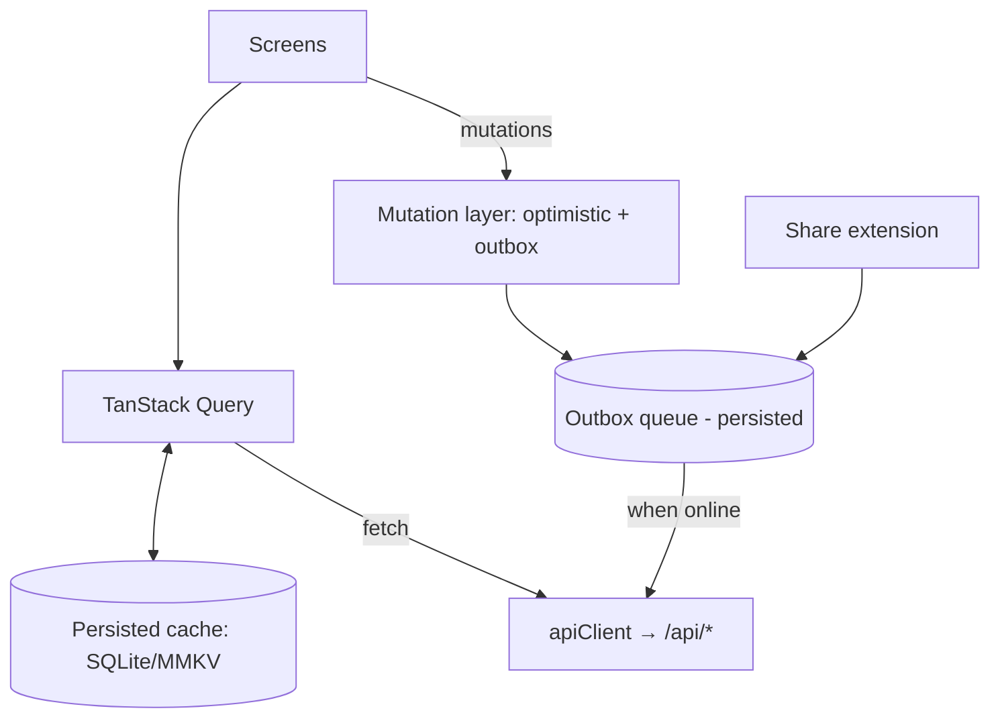

# KAMI Mobile — Design Document

> Audience: Claude Code (and humans) building the KAMI mobile app.
> Companion: [`SPEC.md`](./SPEC.md) defines *what* to build (requirements, screens, API contract, acceptance criteria). This document defines *how it should look, feel and be structured*.
> Read both before writing code. Where they conflict, SPEC.md wins on behaviour and this file wins on visuals.

---

## 1. Product summary

KAMI is a calm, personal **read-later library**: save articles and X posts, read them distraction-free, highlight, and organise. It also follows RSS/newsletters, tracks movies/TV/books on shelves, and plans trips. The web app exists (`/home/user/kami`, TanStack Start + Clerk + Postgres). The mobile app is a **native companion** that uses the **same backend and the same account**.

**Mobile's job is to be the best place to *read* and the fastest place to *save*.** Everything else is secondary.

### Principles

1. **Reading first.** The reader is the hero screen; every other screen exists to get you into it.
2. **Capture in two taps.** Share sheet → saved. No forms, no confirmation dialogs.
3. **Calm.** No badges screaming, no streaks, no gamification. Warm paper tones, generous whitespace, restrained motion.
4. **Offline by default for reading.** Anything saved is readable on a plane. Writes made offline sync later without the user caring.
5. **Server is the source of truth.** The app never invents data the server owns (article extraction, feed polling, lookups). It caches and queues, it does not fork logic.
6. **One account, one backend.** No mobile-only data model.

### Non-goals (v1)

- No separate backend, no on-device article extraction.
- No social/sharing features, no shared shelves editing UI beyond read/write of own lists.
- No journal (paused on web: local-only, no server sync — see §10 of SPEC).
- No tablet-optimised layouts beyond not-breaking; no widgets/watch (v2 ideas listed in SPEC §14).

---

## 2. Technology decisions

| Concern | Decision | Why |
|---|---|---|
| Framework | **React Native + Expo (SDK current stable), TypeScript strict** | Team already writes React/TS; shares types/Zod with web; Expo gives share extensions, OTA, EAS builds |
| Navigation | **Expo Router** (file-based) | Mirrors web's file routing; deep links for free |
| Server state | **TanStack Query v5** + persisted cache (MMKV or SQLite persister) | Same library as web; offline cache + mutation queue |
| Local DB | **expo-sqlite** (+ Drizzle ORM sqlite driver, optional) for article bodies & highlights | Large HTML bodies don't belong in AsyncStorage |
| Small state | **Zustand** for UI prefs (reader font, paper tone, theme) persisted in MMKV | Same as web |
| Auth | **Clerk Expo SDK (`@clerk/clerk-expo`)** with `expo-secure-store` token cache | Same identity provider as web; see SPEC §4 for the required backend change |
| Validation | **Zod** schemas copied/shared from `src/lib/api/types.ts` & services | Single contract |
| Styling | **NativeWind** (Tailwind for RN) *or* StyleSheet + a `theme.ts` tokens file | Tokens in §4 map 1:1 to the web CSS variables |
| HTML rendering | **WebView-based reader** (`react-native-webview`) with injected CSS/JS | Highlights need DOM Range selection; HTML is server-sanitised article HTML |
| Share ingestion | **`expo-share-intent`** (or native Share Extension/Intent filter via config plugin) | iOS Share Extension + Android intent filter |
| TTS | `expo-speech` | Parity with web TTS hook |
| Lint/format | ESLint + Prettier using the repo's `.prettierrc` | Consistency |
| Tests | Jest + React Native Testing Library; Maestro for E2E smoke flows | |

**Monorepo placement:** create `mobile/` at the repo root (sibling of `extension/`). Add it to `pnpm-workspace.yaml`. Do **not** import web `src/` code directly (it pulls in server-only modules). Instead extract pure types into `packages/shared/` *only if needed* (see SPEC §13 for the minimal-change path); otherwise copy the type definitions and keep a comment pointing at the source file.

---

## 3. Information architecture

Bottom tab bar, 5 tabs. Reader and detail screens push on top of the stack and hide the tab bar.

```
Tabs
├── Home        (capture + continue reading + recent)
├── Library     (inbox / archive / favorites, folders, tags, search)
├── Feeds       (subscriptions, unread inbox, newsletters)
├── Shelves     (movies / series / books / wishlist)
└── More        (Vault, Trips, Extracts, Settings)

Stack (pushed over tabs)
├── Reader            /read/[id]
├── Article details   sheet (tags, folder, note, archive)
├── Feed entry        /feeds/entry/[id]   (preview → save to library)
├── Shelf item        /shelves/[type]/[id]
├── Trip              /trips/[id]  (+ chat)
├── Extract source    /extracts/[id]
├── Vault             /vault
└── Auth              /(auth)/sign-in, /(auth)/sign-up
```

Why Vault/Trips/Extracts live under **More**: they are real features but not daily-driver mobile flows. They can be promoted later based on usage.

Global affordances:
- **Pull-to-refresh** on Library, Feeds, Shelves.
- **Command/search** is a search bar at the top of Library (no command palette on mobile).
- **Offline banner**: slim, non-blocking strip under the header when offline; shows pending-sync count when > 0.

---

## 4. Visual language — "washi & sumi"

The web brand is Japanese-paper inspired: warm off-white paper, sumi ink, vermilion accent. Mobile uses **the same tokens** so the two feel like one product.

### 4.1 Colour tokens

Source of truth: `src/styles.css` (`:root` and the dark block). Mirror exactly.

| Token | Light | Dark | Use |
|---|---|---|---|
| `bg` | `#f4efe6` | `#0e0d0b` | App background |
| `paper` | `#faf6ee` | `#151312` | Cards, sheets |
| `paperWarm` | `#ece3d2` | `#1a1714` | Subtle fills, pressed states |
| `surface` | `#fffdf8` | `#1d1a16` | Inputs, elevated surfaces |
| `ink` | `#201b14` | `#e3dcd3` | Primary text |
| `inkSoft` | `#5b5248` | `#b3a89c` | Secondary text |
| `inkMuted` | `#8a7f72` | `#857a6d` | Tertiary text, metadata |
| `faint` | `#c9bda9` | `#3a342c` | Disabled, placeholders |
| `line` | `#e0d5c0` | `#2e2922` | Hairlines, dividers |
| `accent` (`ink-accent`/hanko) | `#9c4a30` | `#d08a5e` | Primary actions, links, active tab |
| `danger` | `#a6331b` | `#c96a55` | Destructive |
| `ok` | `#546250` | (derive) | Success |
| `bamboo` | `#5f6f57` | (derive) | Secondary accent / success tint |

Follow the system colour scheme by default; allow Light / Dark / System in Settings.

### 4.2 Reader paper tones

Three tones, independent of app theme (same as web `src/lib/paper-tones.ts`):

| Id | Name | bg | fg | scheme |
|---|---|---|---|---|
| `pale` | Pale Washi | `#FFFDF9` | `#1d1b18` | light |
| `aged` | Aged Washi | read from `paper-tones.ts` | | light |
| `sumi` | Sumi | read from `paper-tones.ts` | | dark |

Copy the full `vars` map for each from `src/lib/paper-tones.ts` when implementing. The reader sheet takes its colours from the chosen paper tone, **not** the app theme.

### 4.3 Highlight ink colours

From `HIGHLIGHT_COLORS` in `src/lib/store.ts`:

| Id | Label | Swatch |
|---|---|---|
| `vermilion` | Vermilion | `#c84b31` |
| `bamboo` | Bamboo | `#6e7d6a` |
| `sumi` | Sumi | `#43403a` |

Render highlights as a ~25% alpha background of the swatch, with text colour unchanged.

### 4.4 Typography

The web UI uses a **monospace stack** (`ui-monospace, SFMono-Regular, Menlo…`) for chrome — a deliberate, quiet "typewriter" feel. On mobile:

- **UI chrome:** system monospace (`Menlo` on iOS, `monospace`/Roboto Mono on Android). Don't bundle a font unless the result looks wrong.
- **Reader body:** user-selectable (see SPEC §6.4): *Serif* (default: Georgia / `serif`), *Sans* (system), *Mono*. Reading is the one place where comfort beats brand.
- Type scale (sp/pt): caption 12, meta 13, body 16, reader body 18 (adjustable 14–26), title 20, screen title 28. Line-height 1.4 for UI, 1.65–1.75 for reader.
- Respect OS Dynamic Type / font scale up to 200%; layouts must not clip.

### 4.5 Shape, spacing, elevation

- 4-pt spacing grid: 4, 8, 12, 16, 24, 32.
- Screen horizontal padding: 16 (phone). Reader text column: max ~680 px wide, centred on tablets.
- Corner radius: 10 for cards/inputs, 14 for sheets, full for chips/avatars.
- **No heavy shadows.** Separation via hairlines (`line`) and tone shifts (`paper` vs `bg`). One soft shadow allowed for floating action elements.
- Iconography: **Lucide** (`lucide-react-native`), 1.5 px stroke, matches web (shadcn/Lucide).

### 4.6 Motion

- 150–220 ms ease-out for most transitions; no bounces.
- Page transitions: standard platform push. Library ↔ Reader may use a short shared fade.
- Respect "Reduce Motion".
- Haptics: light impact on save success, selection tick when highlighting, none elsewhere.

---

## 5. Screen designs

Wireframes are intentionally low-fidelity; Claude Code should follow structure and hierarchy, not pixel positions.

### 5.1 Home

```
┌──────────────────────────┐
│ KAMI                  ⚙︎ │  header: wordmark, (optional) avatar
├──────────────────────────┤
│ ┌──────────────────────┐ │
│ │ Paste a link…      ➜ │ │  capture field (autofocus off); paste button
│ └──────────────────────┘ │
│  Continue reading        │  horizontally scrolling cards (progress ring)
│ [card][card][card]       │
│  Recently saved          │  vertical list (ArticleRow)
│  ▸ Title … site · 6 min  │
│  ▸ …                     │
└──────────────────────────┘
```

- Capture field: on focus, if the clipboard contains a URL, show a "Paste *domain.com*" chip (don't read clipboard silently on iOS — respect paste permission prompts).
- States: empty (illustration-free; one line "Nothing saved yet. Share a link from any app.") / loading skeleton / error with retry.

### 5.2 Library

- Segmented control: **Inbox · Archive · Favorites**.
- Filter row: folder chip (opens picker), tag chips (horizontal scroll), sort menu (Newest / Oldest / Reading time).
- Search field pinned at top; filters title, site, author, tags, excerpt locally; server search is not required (library is cached).
- `ArticleRow`: hero thumbnail (56×56, optional), title (2 lines), `site · author · N min`, tag chips (max 2 + "+n"), favourite star state.
- Swipe actions: **right** → Archive/Unarchive; **left** → Delete (with undo snackbar, 5 s). Long-press → multi-select → bulk bar (Archive, Tag, Move, Delete) — maps to `POST /api/library/bulk`.
- Infinite scroll via keyset cursor (SPEC §5.2). Total count shown in header.

### 5.3 Reader (hero screen)

```
┌──────────────────────────┐
│ ←        Aa   ♪   ⋯     │  translucent header; auto-hides on scroll down
├──────────────────────────┤
│  Title (serif, large)    │
│  Author · Site · 8 min   │
│  ─────────               │
│  Body …                  │  WebView, paper tone background
│  [highlighted text]      │
│                          │
├──────────────────────────┤
│  ▓▓▓▓▓░░░░ 42%           │  thin progress bar (bottom edge, no chrome)
└──────────────────────────┘
```

- **Header** (`Aa`, TTS, overflow). `Aa` opens the **Reader preferences sheet**: font family, size slider, line height, width/margins, paper tone (3 swatches), justify toggle.
- **Overflow menu:** Favourite, Archive, Tag/Folder…, Note, Open original, Share, Copy link, Delete.
- **Selecting text** shows a custom floating toolbar: three ink colours (create highlight), "Note" (create highlight + open note field), "Copy". Tapping an existing highlight shows: change colour, edit note, delete.
- **Margin notes:** highlights with notes show a small marker; tapping scrolls into a bottom sheet listing all highlights for the article (tap one → scroll to it).
- **Reading progress** is persisted locally per article and restored on reopen (v1: local only; see SPEC §6.7).
- **TTS:** mini-player docked bottom (play/pause, speed 0.75–2×, skip paragraph). Highlights the currently spoken paragraph.
- Immersive: tapping body toggles chrome. Status bar tint follows paper tone.
- Handles `source: "x"` (X posts) with the same renderer; images lazy-load through `/api/img` proxy (SPEC §4.3).

### 5.4 Feeds

- Top: segmented **Unread · All · Saved**; feed picker (sheet listing subscriptions with unread counts + "All feeds" + "Newsletters").
- Entry row: title, source, relative time, unread dot. Tap → **Entry preview** (renders feed-supplied body, sanitised, in the same reader renderer but without highlights) with a prominent **Save to library** button (`POST /api/feeds/entries/:id/article`), which then offers "Open in reader".
- Toolbar: Refresh all (batches, with progress "Checked 20 of 47"), Mark all read, Add feed (URL field → discovery), OPML import via document picker (**v1.1**).
- Newsletters: show the user's private inbound email address with Copy / Share / "New address" (confirm: old address stops working).
- Errors per feed: show last error inline in feed picker with Retry.

### 5.5 Shelves

- Top tabs: **Movies · Series · Books · Wishlist**; each a grid (2 columns) of cover cards (`ShelfCard`), status filter chips (To try / Done / Abandoned), search.
- Add: FAB → search sheet using TMDB / Open Library lookup (`/api/lookup/*`), tap result to add; or manual title.
- Detail screen: cover, title, status control, notes, link, genres. **Series:** season list → episode checklist (toggle watched), progress bar, "Where to watch" (watch providers by country). **Books:** page progress slider / percent.
- Shared lists: if an item list is shared, show member avatars; no member management UI in v1.

### 5.6 Vault (under More)

- All highlights across articles, grouped by article, newest first. Row = highlight text (colour bar), note if any, article title. Tap → open reader scrolled to highlight. Edit note / delete inline. Export (share sheet as Markdown).

### 5.7 Trips (under More)

- List of trips (title, destination, dates, day count). Trip board with three sections (collapsible): **Details**, **Hotels** (shortlist, chosen), **Itinerary** by day with slots (morning/afternoon/evening/night).
- **Chat** tab/sheet with the trip agent: streaming responses, tool-status chips ("Searching the web…", "Added to Day 2"), model picker only if the server reports >1 usable model. Board refetches after each write tool.
- Long-press item → move to day/slot, edit, delete.

### 5.8 Extracts (under More)

- List of saved sources (name, URL, question, last run). Detail: Run / Run live, pending answer rendered as Markdown with **Accept / Discard**, accepted history.

### 5.9 Settings (under More)

Sections: **Account** (name, email, sign out, delete account → deep link to web), **Appearance** (theme), **Reading** (defaults for the reader prefs), **Data** (export library JSON/Markdown via share sheet, clear offline cache), **About** (version, links, licenses).

### 5.10 Auth

- Clerk-hosted flows via Clerk Expo: email + password / email code, Google & Apple (Apple is **required** on iOS if any third-party social login is offered). Keep screens on-brand: paper background, wordmark, single primary button.

### 5.11 Share extension / intent

- Appears as "KAMI" in the iOS/Android share sheet. Accepts URL (and text containing a URL).
- Behaviour: show a tiny confirmation card — spinner → "Saved ✓ · *Title*" → auto-dismiss in 1.2 s. On failure: "Couldn't save — we'll retry" and enqueue to the offline outbox. Tap card → opens app at the article.

---

## 6. Component inventory

Build these once under `mobile/src/components/`, reuse everywhere.

| Component | Notes |
|---|---|
| `Screen`, `Header`, `Section` | Safe-area aware layout primitives |
| `Text` | Variants: `title`, `heading`, `body`, `meta`, `caption`, `mono` |
| `Button` | `primary` (accent fill), `secondary` (outline), `ghost`, `destructive`; loading state |
| `IconButton`, `Chip`, `Segmented`, `Switch`, `Slider` | |
| `Sheet` | Bottom sheet (`@gorhom/bottom-sheet`) for prefs, pickers, details |
| `ArticleRow`, `ArticleCard` | Library/Home |
| `FeedEntryRow`, `FeedPicker` | Feeds |
| `ShelfCard`, `ShelfGrid`, `EpisodeRow`, `ProgressBar` | Shelves |
| `HighlightRow`, `HighlightToolbar` | Reader/Vault |
| `ReaderWebView` | The one hard component — see §8 |
| `OfflineBanner`, `Snackbar`/`Toast`, `EmptyState`, `ErrorState`, `Skeleton` | Feedback |
| `ConfirmDialog` | For destructive actions only |

---

## 7. State, data flow and offline



- **API client** (`mobile/src/api/client.ts`): thin `fetch` wrapper that attaches `Authorization: Bearer <Clerk session token>`, sets `Content-Type: application/json` on bodies, maps `{ error }` + status to typed errors, retries idempotent GETs with backoff, and on `401` refreshes the token once then signs out.
- **Library** is cached in SQLite (full `contentHtml` per article for offline reading). First launch loads pages of 100 using the keyset cursor; background sync fetches remaining pages. Cache invalidates by article `id`; there is no server delta endpoint in v1, so a pull-to-refresh refetches page 1 and merges by id (see SPEC §5.2 and §14 for the delta-sync proposal).
- **Outbox** (persisted, FIFO, per-entity coalescing): create/update/delete of articles, folders, highlights (they live inside the article PATCH), shelf item changes, feed read marks. Entries retry with exponential backoff; permanent failures (4xx other than 401/408/429) are surfaced in a "Sync issues" list in Settings with Retry/Discard.
- **Conflict policy:** last-write-wins per field. The server is authoritative on fetch; the outbox flushes *before* a refetch overwrites local rows with pending changes.
- **Optimistic updates** for: archive, favourite, tag, move, note, highlight CRUD, episode toggle, mark-read. **Not optimistic:** extraction (needs the server), feed refresh, trip chat, extract runs.

---

## 8. Reader rendering design (the hard part)

The server returns sanitised article HTML (`contentHtml`). The mobile reader:

1. Renders it in a `WebView` using a local HTML template: `<style>` generated from the active prefs/paper tone, `<article id="kami">` containing the HTML, and an injected script.
2. The injected script:
   - Computes and reports scroll progress to native (`postMessage({type:"progress", value})`).
   - Handles selection: on `selectionchange` (debounced) sends the selected text + a serialised range; native shows the highlight toolbar (native overlay, so it isn't clipped by the WebView).
   - Applies highlights by **text-anchored matching**: web stores highlights as `{id, text, note, color, createdAt}` (no offsets), so the wrapper must find `text` in the DOM text nodes and wrap it in `<mark data-hid="…" data-color="…">`. Reuse the logic in `src/lib/highlight-html.ts` (port it into the injected script; it is pure). Match should tolerate whitespace differences and cross-element ranges.
   - Reports taps on `<mark>` to native for edit/delete; reports link taps (open in in-app browser `expo-web-browser`, never navigate the WebView away).
   - Lazy-loads images; rewrites remote image `src` to `/api/img?url=…` **with the bearer token via a header-injecting loader or by pre-fetching and caching images to disk** (see SPEC §4.3 — the proxy requires auth).
3. Prefs changes apply instantly by updating CSS variables via `injectJavaScript` (no reload).
4. Security: `originWhitelist={["about:blank"]}`, `javaScriptEnabled` only for our injected script, `onShouldStartLoadWithRequest` blocks all navigation, article HTML is already server-sanitised but still loaded as `source={{ html, baseUrl: "about:blank" }}`.
5. Accessibility: WebView content must remain selectable and respect OS font scaling as a multiplier on the user's reader size.

Alternative considered: render HTML natively (`react-native-render-html`). Rejected for v1 because selection/highlighting across inline elements is much harder to get right natively. Revisit if WebView performance on long articles is poor.

---

## 9. Accessibility

- Minimum 44×44 pt touch targets.
- WCAG AA contrast for all text/token pairs (verify `inkMuted` on `paper` ≥ 4.5:1 for body-size text; if not, darken for small text).
- Screen reader labels on every icon-only button; reader announces title/author/time first; highlight toolbar buttons labelled by colour name.
- Support Dynamic Type/font scale, Bold Text, Reduce Motion, VoiceOver/TalkBack rotor for headings in the reader (`<h1–h6>` kept in HTML).
- Colour is never the only signal (highlight colours also have distinct underline styles: solid / dotted / double — optional setting).

## 10. Performance budgets

| Metric | Budget |
|---|---|
| Cold start to interactive Home (warm cache) | < 2 s on mid-range Android |
| Open article from Library (cached) | < 300 ms to first paint |
| Library list scroll | 60 fps with 5,000 items (FlashList, `getItemType`, memoised rows) |
| Reader on 20k-word article | < 1 s to first paint; highlight apply < 100 ms |
| Share extension save | < 3 s typical (network-bound), never blocks UI |
| Offline cache | Configurable cap (default 500 MB); evict oldest *archived* article bodies first |

## 11. Privacy & security

- Tokens only in `expo-secure-store`. No tokens in logs, analytics or crash reports.
- No third-party analytics in v1. Crash reporting (Sentry) with PII scrubbing is acceptable, off by default behind a Settings toggle.
- Never send article content to anything but the KAMI backend.
- App Transport Security / cleartext: HTTPS only.
- Biometric app lock (Face ID/fingerprint) — optional v1.1 setting.
- Account deletion: link out to the web settings (`/settings`) in v1 (Apple requires an in-app path to *initiate* deletion — the link satisfies this only if the web flow actually deletes the account; verify before App Store submission).

## 12. Release & environments

| Env | API base URL | Clerk instance |
|---|---|---|
| `development` | `http://<LAN-IP>:8080` | Clerk dev keys |
| `preview` | Vercel preview URL | Clerk dev keys |
| `production` | `https://kami.sahilfruitwala.com` (confirm) | Clerk prod keys |

- Config through `app.config.ts` + EAS env (`EXPO_PUBLIC_API_URL`, `EXPO_PUBLIC_CLERK_PUBLISHABLE_KEY`). No secrets in the bundle.
- EAS Build profiles: `development` (dev client), `preview` (internal distribution), `production`. EAS Update for JS-only fixes.
- Bundle identifiers: `com.sahilfruitwala.kami` (iOS & Android) — confirm with owner.
- CI: lint, typecheck, unit tests on every PR (add to existing workflow if any); EAS preview build on `main`.

## 13. Open design questions (decide with the owner before building the affected area)

1. App name/icon: reuse web favicon set, or commission a mobile icon?
2. Should Journal be built locally-only on mobile, or skipped until the server sync returns? (Default: skipped.)
3. Is a tablet/iPad layout in scope for v1? (Default: phone only, iPad runs scaled.)
4. Push notifications (e.g., new items in selected feeds)? Requires server polling that doesn't exist today (feeds poll on demand only). (Default: none in v1.)
